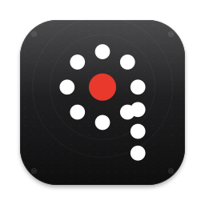
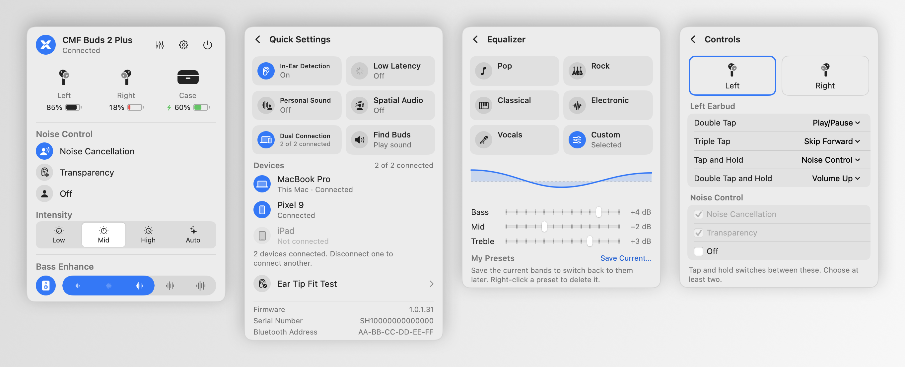
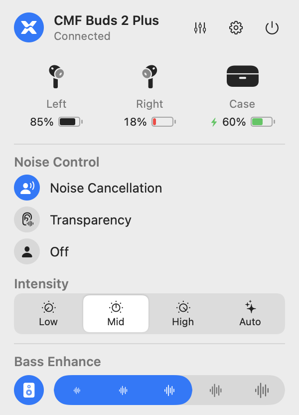
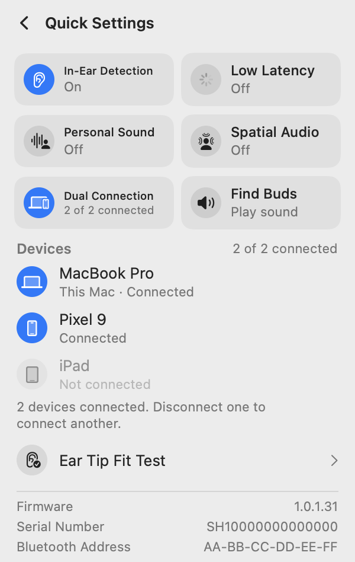
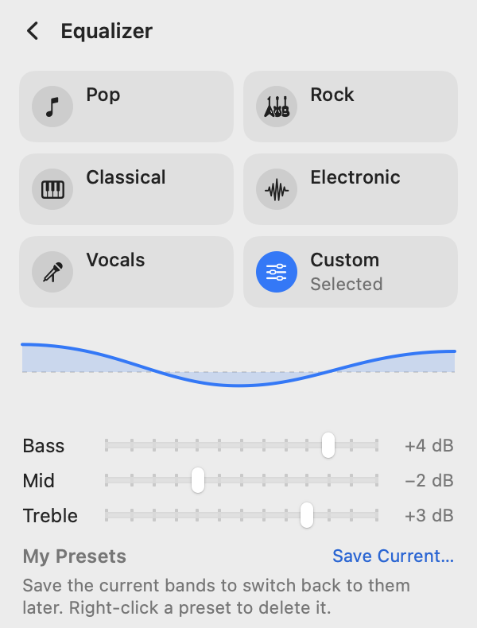
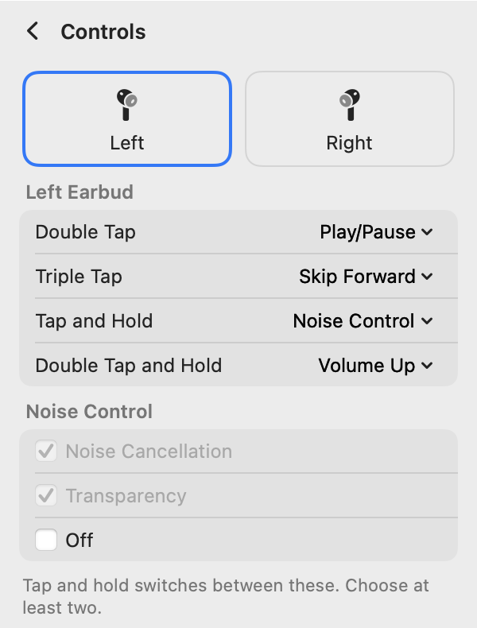

<p align="center">
  
  <h1 align="center">Nothing X Mac</h1>
  <p align="center">
    Control your Nothing and CMF earbuds from the Mac menu bar.<br>
    Native Swift and SwiftUI · about 1 MB download · macOS 13+ · Apple Silicon and Intel
  </p>
  <p align="center">
    <a href="https://github.com/farhancdr/nothing-x-mac/releases/latest"><b>Download</b></a>
    ·
    <a href="#install">Install</a>
    ·
    <a href="#how-to-use">How to use</a>
    ·
    <a href="#build-from-source">Build from source</a>
    ·
    <a href="docs/ARCHITECTURE.md">How it works</a>
  </p>
</p>

<picture>
  <source media="(prefers-color-scheme: dark)" srcset="docs/screenshots/overview-dark.png">
  
</picture>

Nothing's companion app, Nothing X, only exists for phones. On a Mac your
earbuds play audio, but you can't see their battery, switch noise cancellation
or change the EQ without picking up your phone. **Nothing X Mac** puts those
controls one click away in the menu bar, styled like the AirPods menu. It talks
to the earbuds directly over Bluetooth. No account, no internet, no telemetry.

## Features

- **Battery** for the left bud, right bud and case, optionally shown in the menu bar
- **Low battery alerts**: a notification at 20% and again at 10%, without repeats
- **Noise Control**: Noise Cancellation, Transparency or Off, with intensity (Low / Mid / High / Auto)
- **Bass Enhance** with a stepped level slider
- **Equalizer**: presets, a 3-band custom EQ with a live curve, and your own saved presets
- **Quick Settings**: In-Ear Detection, Low Latency, Personal Sound, Spatial Audio,
  Dual Connection (see and switch the buds' other devices) and Find Buds
- **Controls**: change each bud's tap gestures, and pick which modes Tap and Hold cycles through
- **Ear Tip Fit Test**
- **Device info**: firmware, serial number, Bluetooth address
- **Open at Login**, light and dark mode, follows your accent color

Each model only shows the features it supports.

## Supported earbuds

Model data comes from [ear-web](https://github.com/radiance-project/ear-web).

| Nothing | CMF |
| --- | --- |
| Ear (1), Ear (2), Ear, Ear (a), Ear (3), Ear (3a) | Buds, Buds 2, Buds 2a, Buds 2 Plus |
| Ear (stick), Ear (open) | Buds Pro, Buds Pro 2 |
| Headphone (1), Headphone (1) Pro, Headphone (a) | Headphone Pro, Neckband Pro, Clip Pro |

Unknown models get a sensible default feature set. Reports for models not yet
tried are very welcome. Run with `NXM_DEBUG=1` (see below) and open an issue.

## Small and native

This is a ground-up native rewrite of an Electron app. Here's how it compares
with the other macOS apps for these earbuds:

| App | Stack | Download (latest release) |
| --- | --- | --- |
| **Nothing X Mac (this)** | Swift, SwiftUI, IOBluetooth | **1.0 MB** DMG (universal), 3.3 MB installed |
| [yashraut362/nothing-x-mac](https://github.com/yashraut362/nothing-x-mac) | Electron + Swift helper | 245 MB DMG / 223 MB zip |
| [nikiomori/nothing-x-macos](https://github.com/nikiomori/nothing-x-macos) | Swift, SwiftUI | 16.2 MB zip |
| [arunavo4/nothing-x-macos](https://github.com/arunavo4/nothing-x-macos) | Swift, SwiftUI | no release (UI prototype) |

Sizes were measured on 2026-11-19 from each project's latest GitHub release.

It's also light at runtime: one process with no web view and no helper, and it
only touches Bluetooth while your earbuds are connected.

## Install

1. Download **Nothing-X-Mac-x.y.z.dmg** from the
   [latest release](https://github.com/farhancdr/nothing-x-mac/releases/latest),
   open it and drag **Nothing X Mac** into **Applications**.
2. Open it. The app is ad-hoc signed but not notarized by Apple, so the first
   launch is blocked. Go to **System Settings → Privacy & Security** and click
   **Open Anyway**. Or run:
   ```bash
   xattr -dr com.apple.quarantine "/Applications/Nothing X Mac.app"
   ```
3. Allow **Bluetooth** access when asked.

To check a download, compare `shasum -a 256 Nothing-X-Mac-*.dmg` with
`SHA256SUMS.txt` on the release.

The first launch from Applications turns on **Open at Login**. You can turn it
off from the right-click menu.

## How to use

1. **Pair your earbuds** in **System Settings → Bluetooth** as usual and connect them.
2. Click the **Nothing X** icon in the menu bar. The app finds the earbuds by
   itself within a few seconds.

| | |
| --- | --- |
|  | **Main panel**<br>Battery for each bud and the case. Tap a noise mode; while Noise Cancellation is on, pick an intensity. Tap the speaker to toggle Bass Enhance, and tap a step to set its level.<br><br>Top-right buttons: **Equalizer**, **Quick Settings**, **Quit**.<br><br>On models with gestures, **click the left or right bud** to open its Controls. |
|  | **Quick Settings**<br>Tap a tile to toggle it. Spatial Audio switches On/Off, or opens a list on models with several modes. Dual Connection shows the buds' remembered devices: click one to connect or disconnect it (at most two at once). **Find Buds** plays a loud sound, so take the buds out first.<br><br>Further down: **Ear Tip Fit Test** and device info. |
|  | **Equalizer**<br>Pick a preset. **Custom** shows Bass / Mid / Treble sliders with a live curve. Use **Save Current…** to keep a set of bands under a name, click a saved preset to apply it, and right-click it to delete. |
|  | **Controls**<br>Choose the left or right bud, then pick what each gesture does. When Tap and Hold is set to Noise Control, tick which modes it cycles through (at least two). |

**Right-click the menu bar icon** for:

- **Open at Login**
- **Battery in Menu Bar**: Icon Only, Left · Right, Average or Lowest
- **Low Battery Alerts**: on by default. macOS asks to allow notifications the first time your earbuds connect.
- **Quit**

**Tips**

- If it keeps trying to connect, close the Nothing X / CMF app on your phone.
  The earbuds only accept one controller at a time.
- **Esc** goes back to the main page.
- Spinners mean the earbuds haven't confirmed a change yet. Taps on that control
  are ignored until they do (or after 4 seconds).

## Build from source

You need macOS 13+ and either Xcode or just the Command Line Tools
(`xcode-select --install`).

```bash
git clone https://github.com/farhancdr/nothing-x-mac.git
cd nothing-x-mac

scripts/build-app.sh                 # build/Nothing X Mac.app for this Mac's chip
scripts/build-app.sh --install       # …and copy it to /Applications
scripts/build-app.sh --universal     # arm64 + x86_64 (needs the Xcode license accepted)
scripts/make-dmg.sh 0.1.0            # dist/ DMG, zip and SHA256SUMS.txt
```

You can also open `Package.swift` in Xcode, pick the **NothingXMac** scheme and press Run.

### Development

```bash
swift run NothingKitChecks                      # protocol self-checks
NXM_DEBUG=1 swift run NothingXMac               # log every frame to and from the earbuds
NXM_OPEN=1  swift run NothingXMac               # open the panel on launch
NXM_SNAPSHOT=docs/screenshots swift run NothingXMac   # regenerate the screenshots (debug build)
NXM_FAKE_LOW_BATTERY=1 swift run NothingXMac    # sample buds at low battery, to test alerts (debug, run inside an .app)
```

### Releasing

Push a version tag and GitHub Actions does the rest
([`.github/workflows/release.yml`](.github/workflows/release.yml)). It runs the
checks, builds a universal app stamped with the version, packages a DMG and a
zip with checksums, and publishes a GitHub release:

```bash
git tag v0.2.0
git push origin v0.2.0
```

It can also be started by hand from the **Actions** tab (Release → Run workflow).

## Docs

- [Architecture and how it works](docs/ARCHITECTURE.md): modules, connection
  lifecycle, how setting changes are confirmed, the release pipeline (with diagrams)
- [Earbud protocol](docs/PROTOCOL.md): frame format and every command the app uses

## Project layout

```
Sources/NothingKit/        Earbud protocol: framing, codecs, per-model capabilities
Sources/NothingXMac/       Menu bar app: Bluetooth transport, device state, SwiftUI panel
Sources/NothingKitChecks/  Protocol self-checks
Resources/                 Info.plist and app icon
scripts/                   build-app.sh, make-dmg.sh
docs/                      Architecture, protocol, screenshots
.github/workflows/         CI and release
```

## Credits

- Ported from [nothing-x-mac](https://github.com/yashraut362/nothing-x-mac) by
  Yash Raut (MIT): app design, protocol handling, model data, app icon and logo.
- Earbud protocol and model data originally from
  [ear-web](https://github.com/radiance-project/ear-web) by the Radiance project.
- Serial number and ear tip test command ids, and the menu bar battery and saved
  EQ ideas, from [nikiomori/nothing-x-macos](https://github.com/nikiomori/nothing-x-macos).
  That project is GPL-3.0; no code was copied from it, only protocol facts and feature ideas.

Unofficial project, not affiliated with or endorsed by Nothing Technology
Limited. "Nothing" and "CMF" are their trademarks.
